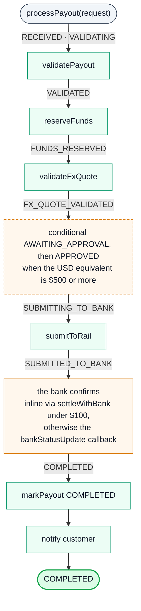
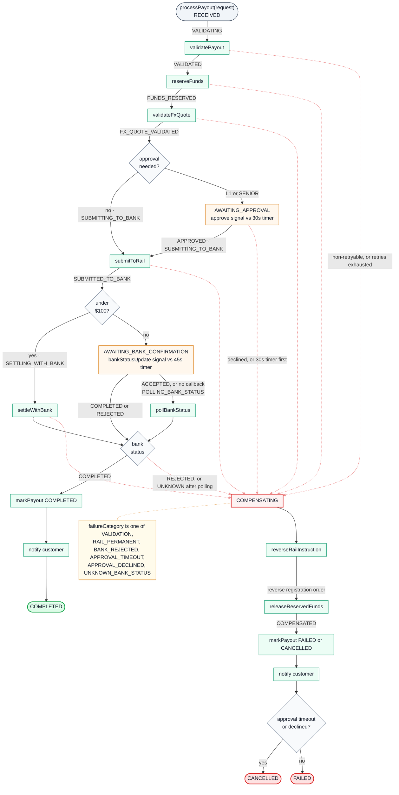
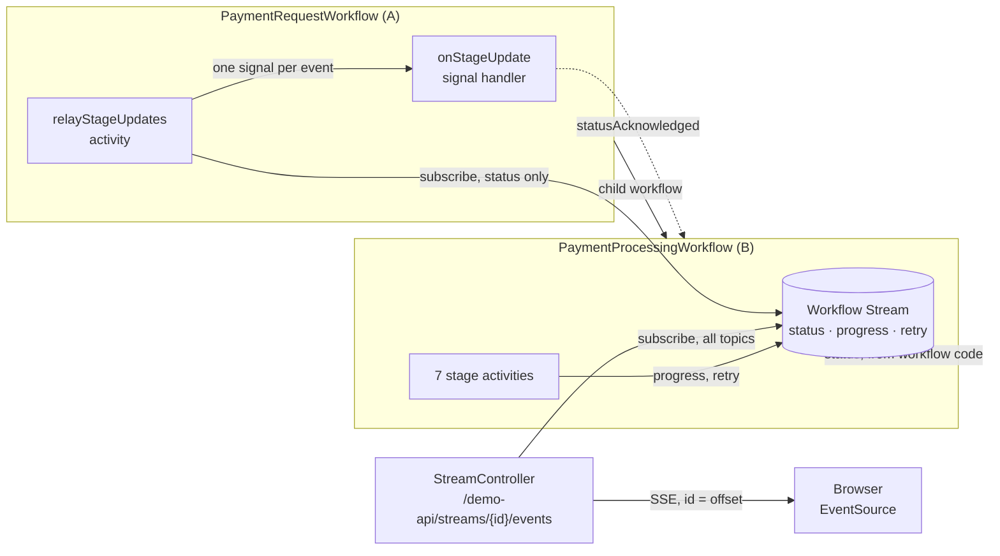

# Payout orchestration — a Temporal demo

A local, runnable payout orchestration demo built on Temporal. One payout workflow with five
scenarios, a sixth scenario built on Workflow Streams, a load simulator, and live worker +
server metrics, all behind a single URL, so the workflow controls and the Temporal UI sit side
by side in one window.

**Backend:** Kotlin · Spring Boot · Temporal Java SDK 1.40.0
**Frontend:** Preact + htm, no build step for the JS · Tailwind v4 for the CSS

---

## Run it

```bash
make preflight     # verify images, tools, fonts and the JDK are all present
make start         # Temporal + Caddy/Prometheus/Grafana + backend
make seed          # six workflows in six distinct states
```

Then open **http://localhost:8080**.

```
make stop            stop everything, waiting for the ports to be released
make reset           stop and clear ALL state, including workflow history
make test            contract tests, over HTTP against a running stack
make test-unit       JUnit unit suite (no stack needed)
make test-integration Spring + in-memory Temporal test server (no stack needed)
make build           compile and run both JUnit suites
make css             recompile the stylesheet
make workers N=3     scale the worker fleet to N JVMs (the cap is 10)
make worker-reload   rebuild the jar and restart the workers on it
make workers-kill    SIGKILL the most recent worker
make workers-down    stop every worker; the API survives and can start replacements
make workers-status  what is polling the task queue
```

### Scaling workers

`N` is the size of the whole fleet, not a number of extras, and it can be changed while load
is in flight. The cap is 10, which is where the Prometheus target list ends.

```
$ make workers N=3
  3 of 10 worker(s) polling the payouts task queue
    worker 1  pid 80008  :8091  alive
    worker 2  pid 81910  :8092  alive
    worker 3  pid 81916  :8093  alive
```

Three workers means three JVMs, not three workers in one. A `WorkerFactory` keys its workers
by task queue and returns the existing one for a repeated call, so extra instances cannot come
from a single process. The API supervises them and launches the same jar again on a different
`--server.port`: worker N on `8090 + N`, since the API itself holds `:8081`. Each process gets
its own identity (`pid@host`) automatically.

They appear as separate rows under **Workers** on the task-queue page. `make workers-kill`
SIGKILLs the most recent one, `make workers-down` stops them all, and the API survives either,
which is what lets it start replacements. Temporal keeps poller entries for a short while after
a worker stops, so the count settles rather than dropping instantly.

Prometheus scrapes `:8091`–`:8100` alongside the API on `:8081`, so each worker shows up on the
dashboard individually: **Live worker instances** tracks the fleet and **Worker task slots
available** gains a series per instance. Targets above the current fleet size read **DOWN**,
which means "not running", not "broken".

One query detail matters if you add panels: the Temporal server exposes
`temporal_worker_task_slots_available` for its own internal system workers, so SDK panels
filter on `job="payout-demo-worker"`. It is the only metric name that overlaps.

| | |
|---|---|
| Demo | http://localhost:8080 |
| Temporal UI | http://localhost:8233 (also embedded in the right pane) |
| Grafana | http://localhost:3000 |
| Prometheus | http://localhost:9090 |

**Prerequisites:** Docker, JDK 21, and Temporal CLI 1.8.3 — the CLI version determines the
bundled Server and Web UI. Any JDK 21 will do: the build discovers one rather than requiring a
particular install location, and the CLI is taken from `PATH`. `make preflight` prints what it
resolved, and `make start` refuses to run on the wrong CLI or without a JDK 21.

---

## What it shows

Six scenarios on the **Demo** tab, each with its own controls and explanatory notes:

1. **Successful payout** — the baseline. Validate → reserve → FX → select rail → submit →
   confirm → complete. Rail, region and currency are fixed server-side rather than exposed as
   controls.
2. **Transient failure + retry** — the rail times out twice, then accepts, on the same
   idempotency key. There is no retry loop in the code; the policy is declarative.
3. **Permanent failure + compensation** — a non-retryable rejection triggers saga
   compensation, in reverse registration order. The compensation activities are scheduled with
   no attempt cap and a flat 5s backoff, bounded only by a one-hour schedule-to-close: giving
   up early would strand the money.
4. **Human approval + timeout** — the workflow blocks durably on a signal. Kill the whole
   application and it is still waiting when the process returns.
5. **Unknown bank status** — the bank accepted an instruction and never confirmed. Rather than
   escalate, the workflow **polls the bank** until it gets a real answer and continues on its
   own. The retry policy on the poll activity *is* the polling loop. Only when polling is
   exhausted does it compensate: reverse the instruction at the bank, release the reservation,
   notify the customer, and flag the outcome `UNKNOWN_BANK_STATUS`.

   The polls show up live on the pending-activity record. Afterwards only the final attempt
   count remains, since retries write no per-attempt history event.
6. **Streamed payment (Workflow Streams)** — workflow A starts workflow B as a child. B runs
   seven stages (validation, approval, funds transfer, ledgering, verification, confirmation,
   settlement) and publishes each one to a Workflow Stream it hosts. The page subscribes over
   server-sent events; A subscribes through a relay activity and receives every status update
   as a signal. A failure selector injects a retried funds transfer or a rejected verification.
   See [Scenario 6: Workflow Streams](#scenario-6-workflow-streams).

The **Metrics** tab runs the load simulator and embeds the Grafana dashboard, so traffic can
be started and observed without leaving the tab.

Starting a payout points the embedded pane at that run's **Timeline** tab
(`/namespaces/{ns}/workflows/{id}/{runId}/timeline`), which needs the run id — the start
response carries one, and the `?payout=` deep link carries it too so a refresh lands on the
same tab. The pane is annotated: the execution carries a static summary and details, each
activity a summary, and both deadline timers one too, so an approval wait reads "Waiting for
SENIOR approval" instead of a bare timer. A **Temporal UI** row above the scenario controls
re-points the pane at Workflows, Workers or Schedules.

Its **Workers** button goes to the task-queue page (`/namespaces/{ns}/task-queues/{queue}`)
rather than Temporal's own Workers view. The task-queue page is scoped to `payouts`, so the
count is just your workers. Temporal's top-level Workers view also lists the
server's internal `temporal-sys-per-ns-tq` worker, so killing one of yours takes the count from
3 to 2 rather than 2 to 1, which is avoidable confusion during the worker-recovery demo.

The top-level **Workers** view exists from Temporal UI 2.50. **Deployments** is a different
thing again: Worker Deployments, i.e. versioning.

---

## The workflow, step by step

Scenarios 1-5 are paths through `PayoutWorkflow`. Scenario 6 has two workflows of its own,
covered in [the next section](#scenario-6-workflow-streams).

### The happy path



Nine steps, no failures. The dashed box is the only conditional step: below $500 there is no
approver. How the bank confirms is chosen by amount as well.

### Every path, including the failures



Three things the diagram does not show:

- Each compensation is registered before the activity it undoes, so the release is keyed on
  `payoutId` rather than the reservation id.
- A validation failure reaches `COMPENSATING` like any other. The saga has nothing registered at
  that point, so it runs nothing and the payout still ends `FAILED`.
- Both durable waits use an explicit `Workflow.newTimer` in a cancellation scope rather than
  `Workflow.await(timeout, cond)`, and the signal handlers ignore arrivals after the deadline.

## Scenario 6: Workflow Streams

Workflow Streams is in Public Preview. The demo uses the experimental
`io.temporal:temporal-workflowstreams` module, versioned with the SDK at 1.40.0.



**B, `PaymentProcessingWorkflow`, hosts the stream.** It creates the stream in its
`@WorkflowInit` constructor, so a subscriber that attaches straight away is accepted. For each
stage it publishes `STARTED`, runs the stage activity, then publishes `PASSED` or `FAILED`, all
on the `status` topic and all from workflow code. Every status event carries a `seq` from 0
with no gaps; the last one is an `OUTCOME` event. The stage activities publish to `progress`
from their own process with `WorkflowStreamClient.fromActivity()`, and on attempt 2 or later they
open with a force-flushed event on `retry`. Funds transfer and ledgering register reversals, so
a rejected verification compensates both.

**A, `PaymentRequestWorkflow`, starts B and follows it.** It waits for the child to start, then
runs `relayStageUpdates`, a long-running activity that subscribes to B's `status` topic and
sends A one `onStageUpdate` signal per event. The handler appends each update and checks its
`seq`: an older one is a re-delivery and is dropped, a skipped one is counted as a gap. A
notifies the customer as soon as it receives confirmation passing or a failure, or from B's
result if B finishes first. If settlement then fails, A sends a correction once B returns. A
signals B `statusAcknowledged` once it holds every `seq` up to the outcome. B stays open until then, for up to 15 minutes, because the log
lives in B's memory and goes when B closes. Before closing, B releases any poll still waiting,
such as an open page's, and the relay stops polling as soon as it has relayed the `OUTCOME`. A's
result comes from the child's result, not from the signals.

**Cancelling.** Cancelling A cancels B, its child. B's parent close policy is `REQUEST_CANCEL`,
so terminating A cancels B too. What a cancelled B does depends on when the cancel arrives.
Mid-payment, it fails the stage it is in, reverses what it had done and publishes a `FAILED`
outcome with reason `cancelled`. While it waits for the acknowledgement, it keeps the outcome it
had reached, `SETTLED` included, and reverses nothing. Either way it stops waiting, records the
ack state `CANCELLED`, hands waiting polls the items they have not had and closes as CANCELED.
A Java workflow with a cancel request closes that way whatever its method returns, so B has no
result for A; it signals its outcome to A with `onProcessingCancelled` before it closes. A
cancelled A still waits for B, notifies the customer and records the outcome in its memo, then
closes as CANCELED.

**The relay resumes from its heartbeat.** It heartbeats the last offset it signalled every 2s,
with a 10s heartbeat timeout, a 5-minute start-to-close per attempt and a 10-minute
schedule-to-close. The SDK sends heartbeats at most every 8s (80% of the timeout), and the
relay signals before it records the offset, so a new attempt can re-send a few events. A drops
those by `seq`. Stopping the only worker 6s into a run re-sends every event delivered so far,
because the opening heartbeat is the only one the server has by then.

**The page.** `StreamController` bridges a subscription to server-sent events and uses the
stream offset as the event id. EventSource reconnects on its own and sends that id back as
`Last-Event-ID`; the page's **Disconnect** / **Reconnect** buttons pass `?from=` instead, since
EventSource cannot set the header. Lane B renders from the stream. Lane A renders from A's memo,
read with `describe`, which needs no worker, so it still answers while every worker is down.
**Workflow: A** and **Workflow: B** point the pane at each workflow.

**Memo and current details.** Each workflow updates its memo (`progress`, `stages`, `stream` or
`relay`, `notification`, `outcome`) and its current details at every transition, from one
function. Each memo upsert is a `WorkflowPropertiesModified` event: 20 on A and 18 on B in a run
that settles. Current details add no event.

**What shows in Temporal UI.** B's history has `__temporal_workflow_stream_publish` signals, one
per batch an activity flushed, and a `__temporal_workflow_stream_poll` update per subscriber
poll. Status events published from workflow code add no event. Stream items are base64 inside
those payloads; A's `onStageUpdate` signals are readable JSON.

**Stream items need the converter passed in.** The stream encodes each item with converters it is
handed explicitly, since workflow code cannot reach the worker's data converter. `StreamCodec`
passes `KotlinxJsonPayloadConverter` to every publisher and subscriber.

**Batch interval 200ms**, down from the 2s default, so the page keeps up.

### What streaming costs on Temporal Cloud

Every Workflow Streams operation that reaches the server is billed as an
[Action](https://docs.temporal.io/evaluate/cloud/actions). In this demo that is each subscriber
poll, each batch a stage activity flushes, each status event the relay signals into A, and each
relay heartbeat that reaches the server.

**Worked example: this demo.** One run of scenario 6 that settles with no retries and no browser
attached:

| Source | Actions |
|---|---|
| `__temporal_workflow_stream_poll` Updates on B, from the relay | 29 |
| `__temporal_workflow_stream_publish` Signals on B, from the stage activities | 21 |
| `onStageUpdate` Signals into A | 15 |
| Relay heartbeats that reached the server | 2-3 |
| **Streaming total** | **67-68** |
| Everything else: two workflow starts, 9 activities, 3 search-attribute upserts, the timer, the ack | 16 |

The poll and publish counts are from B's history; 20 such runs on a local dev server ranged
from 29 to 33 polls and 21 to 24 publishes. Heartbeats are not recorded in history: the relay
runs for 13-16s and sends one at the start, then at most one every 8s.

What adds nothing: status events B publishes from workflow code, which reach subscribers inside
poll results, and current details. Memo upserts are not on the list of Cloud Actions; search
attribute upserts are.

Poll counts are driven by wakeups, not by the topics a subscriber asked for. The poll handler
returns when any item is appended and filters afterwards, so every `progress` batch completes
a relay poll, usually with no `status` item in it: 8 of the 29 polls carried one, since a
stage's `PASSED` and the next stage's `STARTED` arrive together. An open page adds a second
subscription through the SSE bridge with a similar count, and each further page another.

Ways to reduce it in this demo, with what each one trades:

- **Raise the relay's poll cooldown.** `SubscribeOptions.setPollCooldown` defaults to 100ms.
  At 1s, polls that would each wake on a progress batch are coalesced, bringing the relay to
  roughly one poll per second of B's run. Status signals to A can lag by up to that second.
- **Publish fewer progress batches.** Each stage force-flushes its first step and batches the
  rest at 200ms, about three publish Signals per stage. Dropping the force-flush, raising the
  batch interval or publishing fewer steps cuts the Signals and the relay polls they wake. The
  page updates less often.
- **Keep `progress` off B's stream.** With only status events on it, every relay wakeup carries
  one, and polls fall to about the 8 that carry one now. The page's progress and retry rows
  would need another source.
- **Close the page when it is not needed.** Each subscriber pays for its own polls; the
  workflow does not share them.

The relay's heartbeats are bounded by the 8s throttle, and its signals into A by the number of
status events, so neither moves with these settings.

---

## How it fits together

```
Browser ──► Caddy :8080 ──┬─► /, /assets/*, /demo-api/*  ──► Spring Boot :8081 (host)
                          └─► everything else            ──► Temporal UI :8233 (host)

Prometheus :9090 ──┬─► temporal server :8000/metrics
                   └─► backend :8081/demo-api/actuator/prometheus  (SDK + business metrics)
Grafana :3000  ──► Prometheus
```

Only Caddy, Prometheus and Grafana are containers. Temporal and the backend run on the host,
which keeps the edit-run loop fast and makes the "kill the app and watch the workflow survive"
case a plain `kill -9`.

**Why the demo owns only three route prefixes.** Temporal UI is a SvelteKit SPA that loads
its assets from absolute paths (`/_app/immutable/...`). Mounting it under a stripped prefix
breaks it. Giving Temporal the catch-all and namespacing the demo instead means those paths
resolve unchanged, at the cost of one rule: every route this app adds must live under `/`,
`/assets/*` or `/demo-api/*`. Spring's own `/error` and `/actuator` are moved inside
`/demo-api` for exactly this reason.

---

## Things worth knowing if you extend this

**How the bank confirms is chosen by the amount, and that branch is versioned.** Below
`SettlementThresholds.SYNC_BELOW_MINOR` ($100) the rail answers inside the `settleWithBank`
activity: no signal, no 45s timer, `SETTLING_WITH_BANK` in the timeline. At or above it the
workflow waits durably on the callback. Scenarios 1-3 start below the threshold so they run
start to finish unattended; 4 and 5 start above it, because the durable wait is their subject.
The activity answers with the scenario's `resolvedStatus` rather than rolling for an outcome, so
a demo button settles the same way every run, and the load simulator posts its own 80/20 split
to keep a mix.

`Workflow.getVersion("inline-settlement-for-low-value", ...)` gates that branch, so executions
started before the change find no marker and keep the wait. The version is consulted *after* the
amount test, so no marker is written on the majority path. The Java SDK does not record
`TemporalChangeVersion` itself, so the workflow upserts it by hand, which turns retiring the
patch into a query:

```bash
temporal workflow list --query 'TemporalChangeVersion IS NULL AND ExecutionStatus="Running"'
```

`src/test/resources/histories/` holds real executions recorded before a change, and
`PayoutWorkflowReplayTest` replays every one of them against the current workflow code, the
guard for a change that would break runs already in flight. Two are committed:
`pre-inline-settlement-low-value.json`, which fails without this gate, and
`approval-with-timers.json`, an approval run covering both timer outcomes, one cancelled by the
signal and one fired. The directory's own README says which shapes are worth keeping.

**`spring.temporal.connection.target` must not be `local`.** The starter special-cases that
value and calls `WorkflowServiceStubs.newLocalServiceStubs()`, which silently discards the
metrics scope *and* the stub customizers. Spelling out `127.0.0.1:7233` takes the normal path.
Without it there are no SDK metrics.

**Serialization is kotlinx, not Jackson.** `KotlinxJsonPayloadConverter` declares the same
`json/plain` encoding as Jackson, so it replaces Jackson in the converter chain while payloads
stay readable in Temporal UI. `EncodingKeys` is package-private in the SDK, so the wire
constants are inlined.

**Every workflow and activity boundary takes exactly one `@Serializable` data class.**
`PayloadConverter.toData()` only ever sees the runtime object, so sealed types, bare generics
and top-level nulls lose their type information. Model variants as a flat data class with an
enum discriminator.

**`runBlocking` belongs at the activity boundary and nowhere else.** Activity signatures stay
non-suspend because the Java SDK invokes them reflectively and cannot accept a `Continuation`.
Inside the body it is ordinary coroutine code — `delay()`, never `Thread.sleep`.

**The dev server's throughput ceiling is SQLite's journal mode.** `temporal server start-dev`
leaves the database in rollback-journal mode, where readers and writers are mutually exclusive.
The signature is a read slower than a write. `scripts/start-temporal.sh` starts it with
`--sqlite-pragma journal_mode=WAL` and raises `history.shardIOConcurrency` from its default of
1, which is what lets the load simulator sustain roughly 45–50 payouts/s rather than building a
backlog. Above that the constraint is the server retiring history tasks, not the size of the
worker fleet: scaling workers up while executor slots sit idle does not help.

**Business metrics come from the API layer**, never from workflow code, where a counter would
double-count on every replay. `StatusCollector` derives them from a Temporal visibility query
over the `businessStatus` search attribute, the same query the Temporal UI filter box takes.
Only the states in `FINDABLE_STATUSES` publish that attribute, so those are the ones a query can
filter on; dropping the rest changes the command stream, so it sits behind a second version
marker, `visibility-milestones-only`.

**Workflow IDs use `REJECT_DUPLICATE`.** The default `AllowDuplicate` permits a second payout
once the first has *closed*, which is the wrong answer for a system that must not pay twice.

---

## Layout

```
backend/kotlin/          Spring Boot app: API + worker + static assets, one jar
  src/main/kotlin/com/example/payouts/
    app/                 payload converter, Temporal config
    model/{domain,workflow,activity}/   one request/response pair per boundary
    model/{stream,memo}/ scenario 6: stream items and memo values
    workflow/            PayoutWorkflow + impl; scenario 6's two workflows
    activities/          activity interfaces and mocks (delay, log, canned result),
                         scenario 6's stage activities and stream relay
    api/                 REST controllers, metrics, status collector
    scenario/            ScenarioStore — failure-injection config, shared with the workers
    worker/              WorkerSupervisor — forks and supervises the worker JVMs
    simulation/          load generator
  src/test/              JUnit 5 unit suite — TestWorkflowEnvironment, time skipping
    resources/histories/ exported histories, replayed against the current code
  src/integrationTest/   Spring Boot against the SDK's in-memory Temporal test server
  src/css/app.css        Tailwind source  (compiled output is committed)
backend/contract/        the demo backend contract, for future SDK implementations
config/                  Caddyfile, Prometheus, Grafana provisioning + dashboard
scripts/                 start / stop / reset / seed / contract-test / scale-workers,
                         plus java-home + temporal-bin (tool resolution)
tools/tailwindcss        vendored standalone binary, no npm anywhere
```

The dashboards under `config/grafana/dashboards/_upstream-*.json` are Temporal's
**community-driven** example dashboards, kept for reference. `payout-demo.json` is the one
provisioned and embedded.

---

## Status

Single backend implementation today. `backend/contract/` describes what a second SDK
implementation would have to satisfy, and `scripts/contract-test.sh` is that contract made
executable. It drives the HTTP API only, so any future backend can be checked against it.

Alongside it, `make build` runs two JUnit 5 suites that need nothing running: a unit suite on
`TestWorkflowEnvironment` with time skipping (which is how the 30s approval and 45s bank
deadlines get tested at all), and an integration suite that boots the whole Spring context
against the SDK's in-memory test server. Those are Java-SDK-specific and deliberately not part
of the cross-SDK contract.

Every backend test supplies its own request, so nothing covered the request the *UI* posts.
`DemoScenarioDefaultsTest` closes that gap. It reads the shipped `app.js`, reconstructs every
body the six buttons can send, and checks each one against the production constants — amounts
against `ApprovalThresholds`, every JSON key against `StartPayoutBody`, and the injected failure
counts against the smallest retry cap the workflow can draw. Each of those fails silently in the
browser: unknown JSON properties are dropped rather than rejected, so a stale key returns 200 and
the scenario runs on defaults.

`PayoutWorkflowReplayTest` is the other guard. It generates histories in-process, and also
replays any `temporal workflow show --output json` export left in
`src/test/resources/histories/`, which is how a change that would break in-flight executions
gets caught before it ships.

| Backend | SDK | Status |
|---|---|---|
| Kotlin | Temporal Java SDK | Reference implementation |
| Java, Go, TypeScript, Python, .NET | — | Not started |
